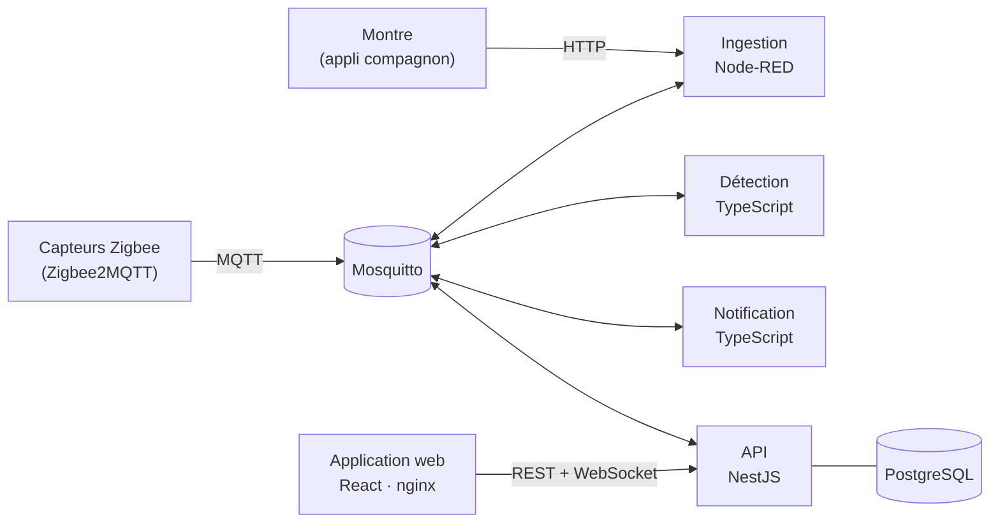

# Veille Senior : détection des chutes et de l'inactivité chez la personne âgée autonome

**Détecter les chutes et les périodes d'inactivité anormale d'une personne âgée autonome vivant seule, et prévenir la bonne personne (famille ou équipe médicale) selon la gravité.**

Un capteur isolé n'est pas fiable : une personne immobile peut dormir ou regarder la télévision, un choc au poignet peut être un geste brusque. Le système **croise plusieurs signaux** (mouvement par pièce, bandes de pression du lit et du fauteuil, chute et fréquence cardiaque de la montre) et **demande d'abord à la personne** si tout va bien avant d'alerter quelqu'un.

La personne est **actrice** du système, pas seulement surveillée : elle répond « tout va bien », demande de l'aide, déclare ses sorties, voit son état et celui de sa montre.

| Document | Contenu |
|---|---|
| [Architecture](docs/Architecture.md) | Modèle C4 (contexte, conteneurs, composants), échanges dans le temps, collecte / traitement / stockage des données, déploiement, choix technologiques |
| [Analyse DDD](docs/DDD_specifications.md) | Langage métier, scénarios (*domain stories*), sous-domaines, *bounded contexts*, *context map*, éléments tactiques |
| [Décisions (ADR)](docs/adr/README.md) | 12 décisions structurantes : contexte, choix, conséquences, alternatives |
| [Analyse des risques (AMDEC)](docs/Matrice_risques.md) | Risques de l'architecture, criticité, mesures en place et à venir |
| [Format des événements](docs/format-evenements.md) · [Topics MQTT](docs/topics-mqtt.md) · [Contrat de l'API](docs/contrat-api.md) | Contrats entre composants (vérifiés par la CI) |
| [Capteurs et ingestion](services/ingestion/README.md) | Capteurs réels reproduits, formats bruts acceptés, simulateur |

---

## 1. Personas et vues

Une seule application web, **trois vues** : la vue dépend du rôle du compte connecté.

| Persona | Besoin | Ce que sa vue montre | Ce qu'elle peut faire |
|---|---|---|---|
| **Personne âgée** (René) | Rester autonome et en sécurité, garder la main | Son état (« tout va bien » ou la question « Avez-vous chuté ? » avec compte à rebours), sa fréquence cardiaque du jour, ses dernières alertes, son absence en cours, un avertissement si sa montre ne transmet plus | **Tout va bien**, **J'ai besoin d'aide**, **Je m'absente** (avec heure de retour), **Je suis rentré(e)** |
| **Famille** (Marie, sa fille) | Être rassurée, n'être dérangée que si c'est important | État de la personne (dernière activité, pièce, absence), alerte en cours et sa gravité, prise en charge par le médical, équipement qui pose problème, historique, notifications | Marquer une notification comme lue |
| **Équipe médicale** (Dr Martin) | Des informations fiables et détaillées, des réglages adaptés à la personne | Tout ce que voit la famille, plus la cause de chaque escalade, la fréquence cardiaque sur 24 h, l'état détaillé de chaque capteur, les seuils d'inactivité | **Prendre en charge** et **clôturer** une alerte, **régler les seuils** d'inactivité |

Les données sont filtrées **par l'API** selon le rôle et la relation consentie : la famille ne reçoit jamais la cause clinique ni la fréquence cardiaque.

---

## 2. Données

### Entrées

| Donnée | Source (appareil réel reproduit) | Transport | Nature |
|---|---|---|---|
| Mouvement par pièce | Détecteurs **Aqara RTCGQ11LM** (Zigbee), via **Zigbee2MQTT** | MQTT `zigbee2mqtt/{sensorId}` | Événement à chaque détection |
| Lit / fauteuil occupé | Bandes de pression **Tuya TS0601** (Zigbee), via Zigbee2MQTT | MQTT | État, retenu seulement quand il change |
| Chute (pic d'impact), fréquence cardiaque, bouton d'aide, batterie | **Montre connectée** (accéléromètre, cardio), via son appli compagnon sur le smartphone | HTTP `POST /ingest/watch` | Événements et mesure périodique |
| Batterie et signe de vie | Rapports périodiques de tous les capteurs | MQTT ou HTTP | Périodique |
| **Saisies manuelles** | Senior : « tout va bien », « aide », « je m'absente » ; médical : seuils, prise en charge, clôture | Application → API | Ponctuel |

Les deux familles de capteurs demandent des **traitements différents** : les détecteurs de mouvement envoient un événement à chaque passage, les bandes de pression republient leur état en continu (il faut ne garder que les changements), la montre passe par HTTP avec ses propres limites de valeurs. Les capteurs sont **simulés**, mais chacun reproduit les **messages réels** de l'appareil (topics et champs de Zigbee2MQTT) : brancher de vrais capteurs ne changerait rien au système ([détails](services/ingestion/README.md#capteurs-réels)).

### États calculés (ni entrées, ni sorties brutes)

- **Pièce courante et dernière activité** : reconstruites à partir des événements de mouvement et de pression.
- **Profil d'activité** : seuils d'inactivité par plage horaire (jour, nuit ; au lit, le plus long), absence en cours, capteurs attendus. C'est la référence contre laquelle l'activité est comparée.
- **État des capteurs** : en marche, muet, batterie faible.
- **Alertes** : levée de doute, niveau 2 (`WARNING`), niveau 3 (`CRITICAL`), sur une échelle de gravité à 4 niveaux ([ADR 0005](docs/adr/0005-echelle-de-gravite.md)).

### Sorties

| Sortie | Pour qui | Canal |
|---|---|---|
| « Tout va bien ? » (levée de doute, 60 s) | Personne âgée | Vue senior, en temps réel |
| Alerte de niveau 2 puis 3, avec sa cause (médical) | Famille, équipe médicale | Vues et boîte de réception, en temps réel |
| Capteur muet, batterie faible | Équipe médicale (montre muette : aussi la famille) | Vues et boîte de réception |
| Historique des alertes, courbe cardiaque, état des capteurs | Selon le rôle | Vues |

---

## 3. Architecture en bref



- **Node-RED** ne fait que **normaliser** les formats des capteurs (couche anti-corruption) et rejeter les messages invalides.
- La **détection** est le cœur de métier : elle croise les signaux en mémoire (chute, inactivité, absence, capteurs muets) et publie des événements de domaine. Elle ne lit jamais la base.
- La **notification** décide quels rôles prévenir ; l'**API** remet aux personnes qui ont une relation consentie, tient le journal et l'historique, et sert les trois vues (REST + WebSocket).
- Les composants échangent par **MQTT** (un seul broker, déjà imposé par les capteurs Zigbee, [ADR 0002](docs/adr/0002-mqtt-seul-bus-de-messages.md)) quand il s'agit d'événements, et par **HTTP** quand il faut une réponse (montre, démarrage de la détection, boutons de l'application).

| Couche | Technologie | Pourquoi |
|---|---|---|
| Ingestion | Node-RED 4.1 | MQTT et HTTP natifs, simulateur intégré ; aucune logique métier |
| Messagerie | Mosquitto (MQTT) | Imposé par les capteurs, suffisant pour le volume ([ADR 0002](docs/adr/0002-mqtt-seul-bus-de-messages.md)) |
| Détection, notification | TypeScript sans framework + mqtt.js | Domaine testable avec un temps simulé, images minimales ([ADR 0001](docs/adr/0001-detection-typescript-mqttjs.md), [0008](docs/adr/0008-service-de-notification.md)) |
| API | NestJS 11 + Prisma 5 + socket.io | Droits, temps réel, migrations typées ([ADR 0006](docs/adr/0006-api-nestjs-prisma-journal.md)) |
| Stockage | PostgreSQL 16 | Un seul système pour les relations, les mesures et le journal |
| Application | React 19 + Vite, servie par nginx | Une application, trois vues, une seule origine ([ADR 0009](docs/adr/0009-application-web-react-nginx.md)) |
| Contrat | `packages/shared-types` | Messages et vues définis une fois (JSON Schema + types), vérifiés par la CI |

Détail complet : [docs/Architecture.md](docs/Architecture.md).

---

## 4. Lancer le projet

**Prérequis : Docker** (Docker Desktop, ou Docker Engine avec Compose v2). Rien d'autre : ni Node.js, ni base de données, ni broker sur la machine.

```bash
git clone https://github.com/zaynab-nachabe/semoule-tipiak.git
cd semoule-tipiak
cp .env.example .env              # PowerShell : Copy-Item .env.example .env
docker compose up --build -d
```

Le premier lancement télécharge les images et construit les services (quelques minutes). Ensuite :

| Adresse | Quoi |
|---|---|
| **http://localhost:8080** | **L'application** : choisir un compte (René le senior, Marie sa fille, Dr Martin) |
| http://localhost:1880 | Node-RED : onglet **Simulateur** pour envoyer des messages de capteurs |
| http://localhost:3000/health | État de l'API |

Pour voir les trois vues en même temps, ouvrir **un onglet par compte** (la session est propre à chaque onglet).

```bash
docker compose ps                 # tous les services doivent être « Up » (healthy pour mosquitto, postgres, api-gateway)
docker compose logs -f detection  # une ligne JSON par décision de la détection
docker compose down               # arrêter (garder les données)
docker compose down -v            # arrêter et repartir de zéro
```

**Si un port est déjà pris** (8080 ou 5432) : mettre par exemple `WEB_PORT=8081` ou `POSTGRES_PORT=5433` dans `.env`, puis relancer.

---

## 5. Vérifier les choix d'architecture : démonstration

Les délais réels (levée de doute 60 s, passage au niveau 3 après 5 min…) sont longs pour une démonstration. Pour les raccourcir, renseigner dans `.env` puis relancer `docker compose up -d` :

```bash
PRE_CONFIRMATION_DELAY_S=20
RECOVERY_WINDOW_S=30
CRITICAL_ESCALATION_DELAY_S=30
INACTIVITY_CHECK_INTERVAL_S=10
ABSENCE_GRACE_S=30
```

Les boutons cités sont dans l'onglet **Simulateur** de Node-RED (http://localhost:1880) : cliquer sur le carré à gauche d'un bouton envoie le message réel du capteur.

| Ce qu'on vérifie | Comment | Résultat attendu |
|---|---|---|
| **Levée de doute, puis escalade** (scénario A, [ADR 0003–0005](docs/adr/README.md)) | « Montre : chute (impact 9.8 g) » ; ne rien faire | Vue senior : « Avez-vous chuté ? » et compte à rebours. À la fin : alerte de niveau 2 chez la famille et le médical, notifications. Plus tard : niveau 3, notifications urgentes. Le médical **prend en charge** puis **clôture** ; la famille le voit en direct |
| **La personne répond** | Nouvelle chute, puis **Tout va bien** dans la vue senior | L'alerte est annulée ; la famille n'est jamais sollicitée. La réponse passe par l'API puis Node-RED, comme le bouton de la montre ([ADR 0007](docs/adr/0007-actions-application-via-ingestion.md)) |
| **Relèvement : un signal ne suffit pas** ([ADR 0004](docs/adr/0004-sequence-de-relevement.md)) | Nouvelle chute, puis « PIR chambre : mouvement » et, dans les 30 s, « Bande de pression du lit : quelqu'un se couche » | Levée de doute annulée (activité **puis** stabilité). Avec le seul mouvement, l'alerte part quand même |
| **Demande d'aide** | **J'ai besoin d'aide** dans la vue senior (ou « Montre : bouton d'aide ») | Niveau 3 immédiat, notifications urgentes |
| **Inactivité prolongée** (scénario B, [ADR 0010](docs/adr/0010-detection-inactivite.md)) | Vue médicale, carte **Seuils d'inactivité** : **Modifier**, cocher « Autres heures », durée 1 min, enregistrer. Puis « PIR cuisine : mouvement » (après une alerte, la surveillance attend un mouvement avant de reprendre), « Montre : fréquence cardiaque 72 », et attendre ~1 min sans autre mouvement | « Tout va bien ? » dans la vue senior, puis niveau 2 (pouls normal : la personne dort peut-être). Sans fréquence cardiaque récente : **niveau 3 directement**. Remettre ensuite les seuils (2 h de 07:00 à 22:00, 10 h la nuit) |
| **Absence déclarée** (scénario C, [ADR 0011](docs/adr/0011-absence-declaree.md)) | Avec le seuil d'une minute : **Je m'absente** dans la vue senior ; attendre | Aucune alerte d'inactivité ; la famille voit « Sorti(e), retour prévu à … ». Puis « PIR cuisine : mouvement » (après 30 s) : l'absence se termine seule |
| **Capteur en batterie faible** ([ADR 0012](docs/adr/0012-surveillance-capteurs.md)) | « PIR chambre : rapport périodique, batterie 12 % » | Carte **Capteurs** de la vue médicale : « Batterie faible », notification au médical. La montre sans aucun signal pendant 15 min est déclarée muette : la famille aussi est prévenue |
| **Normalisation et rejet** | Boutons « ERREUR : … » | Rien n'arrive à la détection ; le message est publié sur `ingestion/rejected` avec son motif (panneau *debug* de Node-RED) |
| **Droits par rôle** | Comparer les vues famille et médicale sur une même alerte | La famille n'a ni la cause de l'escalade, ni la fréquence cardiaque ; seul le médical règle les seuils et clôture |

### Tests automatiques

La CI (GitHub Actions) les exécute à chaque push : vérification des types, tests du contrat d'événements et du flow Node-RED, tests de la détection (temps simulé), de la notification, de l'API et de l'application, puis un **scénario de bout en bout** sur toute la pile Docker (chute et escalade, notifications et droits, actions du senior, inactivité, absence, batterie faible, application servie par nginx). Pour les lancer en local, il faut en plus Node.js 22 : `npm install`, `npm test`, et le scénario décrit dans [apps/api-gateway](apps/api-gateway/README.md#tests).

---

## 6. Fonctionnalités non réalisées ou différentes de la spécification

| Prévu dans la spécification | Ce qui est fait | Pourquoi / où ça se brancherait |
|---|---|---|
| Profil d'activité **appris** à partir de l'historique (routine par tranche horaire) | Seuils d'inactivité **configurés** par l'équipe médicale, par plage horaire (jour, nuit), plus long au lit | Apprendre une routine fiable demande des semaines de données ; un calcul périodique sur l'historique des signaux (déjà stocké) produirait le même `ActivityProfile`, sans changer la détection |
| Tendances d'activité, résumé de la journée | Dernière activité et pièce courante ; fréquence cardiaque sur 24 h (médical) | Endpoint `GET /seniors/{id}/activity` prévu au contrat, non réalisé |
| Seuils par pièce (ex. salle de bain) | Seuils pour tout le logement | Écarté pour garder la configuration simple ([ADR 0010](docs/adr/0010-detection-inactivite.md)) |
| Contacts d'urgence modifiables | Table et données de démonstration, pas d'écran ni d'endpoint | Utiles avec un canal d'appel externe, absent |
| Gestion des comptes et des relations, consentement géré par le senior | Comptes et relations consenties créés par les données de démonstration ; la règle d'accès (rôle × relation consentie, révocation) est appliquée à chaque requête | Pas d'écran de gestion ; un seul senior en démonstration (tout est pourtant indexé par senior) |
| Question « Tout va bien ? » **sur la montre** | Affichée dans la vue senior de l'application | La montre simulée n'a pas de canal retour ; le bouton « annulation » du simulateur reproduit sa réponse |
| Notifications SMS / push, accusé de réception, relance | Notifications **dans l'application** seulement ; lecture datée, pas de relance | Un canal externe s'ajouterait dans le seul service de notification ([ADR 0008](docs/adr/0008-service-de-notification.md)) ; voir R10 |
| Authentification réelle | Choix d'un compte dans une liste, jeton JWT | Hors du périmètre du sujet (risque R14) |
| Chiffrement en transit et au repos, durée de conservation des données de santé | Absents (HTTP en local, historique conservé sans limite) | Voir R5 |
| Vrais capteurs | Simulés dans Node-RED, au format réel de Zigbee2MQTT et de l'appli de la montre | Brancher une passerelle Zigbee2MQTT sur le même broker suffirait |
| Ajout de capteurs depuis l'application | Registre des capteurs dans Node-RED et dans l'API (copie) | Voir R20 |

Les autres limites connues (état de la détection en mémoire, instance unique de chaque service…) sont dans les ADR et l'[analyse des risques](docs/Matrice_risques.md).

---

## 7. Organisation du dépôt

```
packages/shared-types   contrat partagé : JSON Schemas, types, topics, tests de contrat
services/ingestion      Node-RED (flows d'ingestion et simulateur)
services/detection      détection : domaine (DDD) et adaptateurs
services/notification   notification
apps/api-gateway        API NestJS, schéma et migrations Prisma, scénario de bout en bout
apps/web                application web (3 vues), nginx
infra/                  configuration du broker, guide de lancement détaillé
docs/                   architecture, DDD, risques, contrats, ADR
```

Chaque service a son propre README (rôle, organisation, paramètres, tests, limites). Règles de contribution : [CONTRIBUTING.md](CONTRIBUTING.md).
