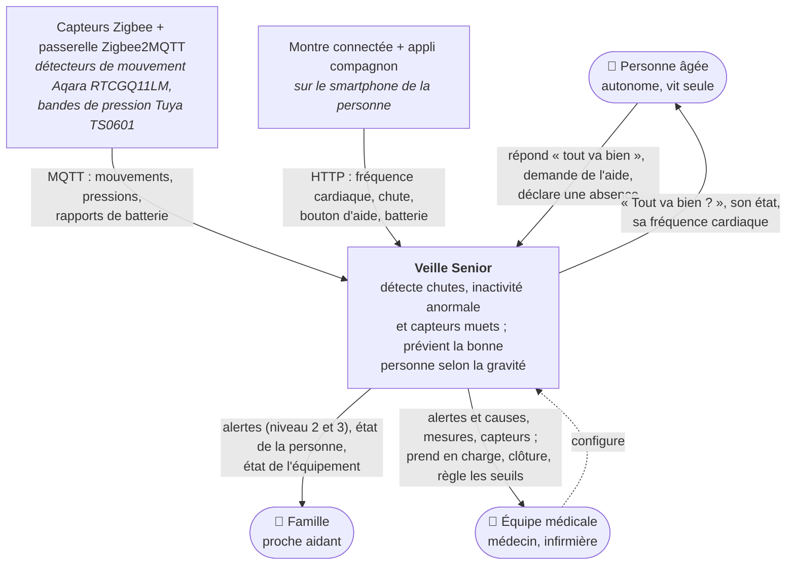
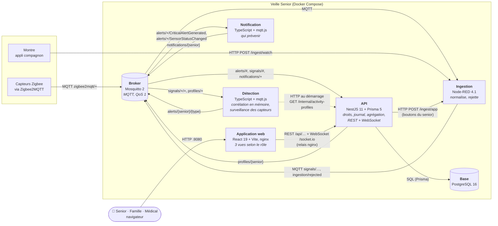
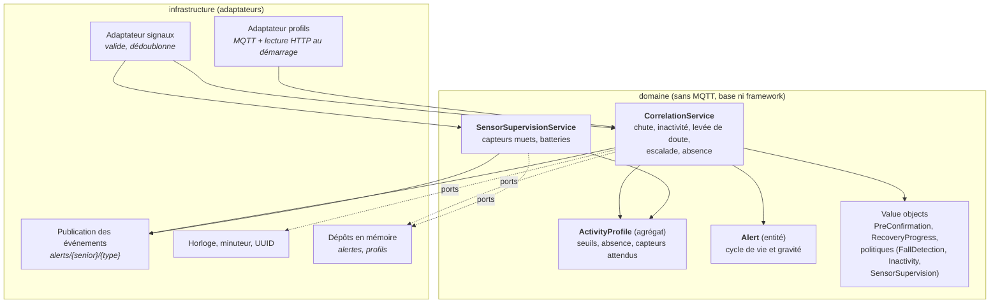
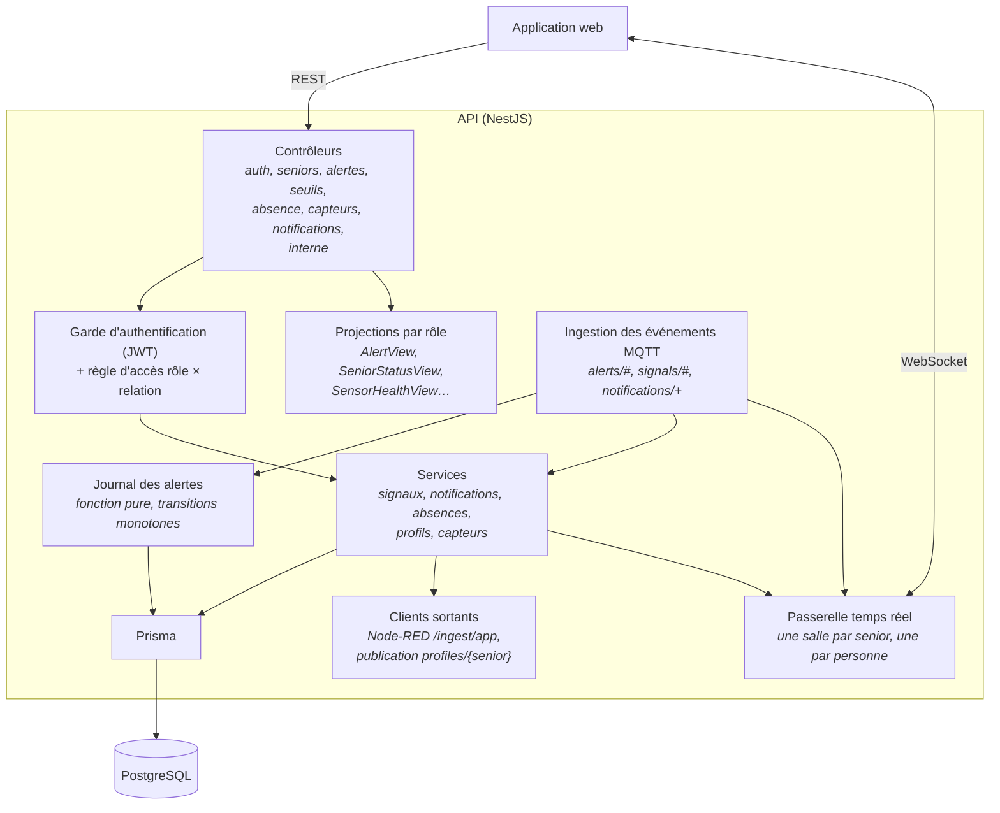
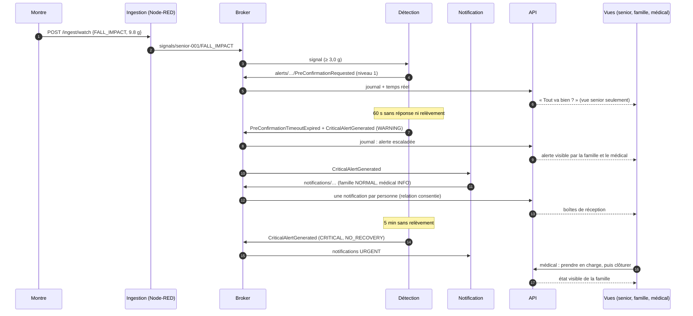
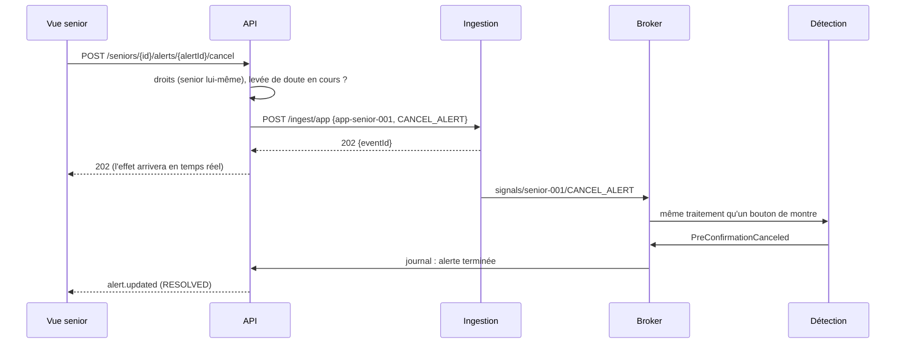
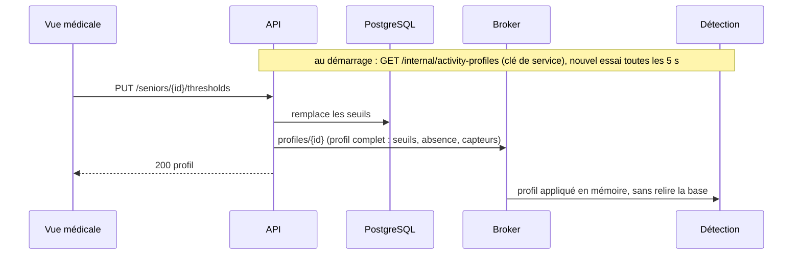

# Architecture logicielle

Ce document présente l'architecture du système à plusieurs niveaux de détail, selon le **modèle C4** : le contexte (niveau 1), les conteneurs (niveau 2), puis les composants des deux conteneurs qui portent la logique (niveau 3). Il décrit ensuite les échanges dans le temps, la collecte, le traitement et le stockage des données, le déploiement et les choix technologiques.

Les décisions structurantes sont justifiées dans les [ADR](adr/README.md) ; le vocabulaire métier et la modélisation dans le [DDD](DDD_specifications.md) ; les risques dans la [matrice des risques](Matrice_risques.md).

**Principes qui guident l'ensemble**

1. **Croiser les signaux avant d'alerter.** Un capteur isolé n'est pas fiable : toute la logique de décision vit dans un seul service, la détection, testé sans infrastructure.
2. **Normaliser à l'entrée.** Les capteurs parlent chacun leur langue ; une seule couche (Node-RED) les traduit dans un format commun. Le reste du système ne connaît que ce format.
3. **Un contrat partagé.** Messages, topics et vues de l'API sont définis une fois, dans `packages/shared-types` (JSON Schema + types TypeScript + documentation), et vérifiés par la CI.
4. **La détection ne lit jamais la base.** Elle garde son état en mémoire ; sa configuration lui est livrée par l'API (au démarrage, puis par message).
5. **Une seule porte d'entrée pour l'application** : l'API, qui vérifie les droits (rôle × relation consentie) et projette chaque donnée selon le rôle.

---

## 1. Contexte (C4, niveau 1)



| Acteur ou système | Ce qu'il apporte | Ce qu'il reçoit |
|---|---|---|
| **Personne âgée** | Réponses à la levée de doute, demande d'aide, déclaration d'absence | La question « Tout va bien ? », son état, sa fréquence cardiaque, ses alertes |
| **Famille** | — (consultation) | Les alertes à partir du niveau 2, l'état de la personne et de l'équipement, sans données médicales détaillées |
| **Équipe médicale** | Prise en charge et clôture des alertes, seuils d'inactivité | Les alertes avec leur cause, la fréquence cardiaque et son historique, l'état détaillé des capteurs |
| **Capteurs Zigbee** (simulés) | Messages au format réel de Zigbee2MQTT, sur `zigbee2mqtt/{sensorId}` | — |
| **Montre** (simulée) | Messages HTTP de son appli compagnon, sur `POST /ingest/watch` | — |

> Les capteurs sont simulés (onglet **Simulateur** de Node-RED), mais chacun reproduit un appareil du commerce et ses messages réels : voir [services/ingestion/README.md](../services/ingestion/README.md#capteurs-réels).

---

## 2. Conteneurs (C4, niveau 2)



| Conteneur | Technologie | Responsabilité | Entrées | Sorties | État |
|---|---|---|---|---|---|
| **Ingestion** | Node-RED 4.1.12 | Couche anti-corruption : traduit chaque format de capteur en signal normalisé ; rejette les messages invalides (file de rejet). Aucune logique métier. | `zigbee2mqtt/+` (MQTT), `POST /ingest/watch` et `/ingest/app` (HTTP) | `signals/{seniorId}/{type}`, `ingestion/rejected` | Registre des capteurs (dans le flow) |
| **Broker** | Mosquitto 2 | Bus de messages unique : capteurs et échanges internes ([ADR 0002](adr/0002-mqtt-seul-bus-de-messages.md)) | — | — | Sessions persistantes et messages en attente (volume) |
| **Détection** | TypeScript, mqtt.js, esbuild ([ADR 0001](adr/0001-detection-typescript-mqttjs.md)) | Cœur de métier : chute, inactivité, échelle de gravité, surveillance des capteurs | `signals/+/+`, `profiles/+`, profils lus à l'API au démarrage | `alerts/{seniorId}/{eventType}` | **En mémoire** : alertes en cours, dernières activités, état des capteurs |
| **Notification** | TypeScript, mqtt.js ([ADR 0008](adr/0008-service-de-notification.md)) | Décide quels **rôles** prévenir, avec quelle priorité et quel texte ; journal | `alerts/+/CriticalAlertGenerated`, `alerts/+/SensorStatusChanged` | `notifications/{seniorId}` | Aucun |
| **API** | NestJS 11, Prisma 5, socket.io ([ADR 0006](adr/0006-api-nestjs-prisma-journal.md)) | Point d'entrée unique de l'application : authentification, droits, projection par rôle, journal des alertes, historique des signaux, boîtes de réception, absences, seuils, registre des capteurs | REST/WebSocket de l'application, `alerts/#`, `signals/#`, `notifications/+` | REST/WebSocket, `profiles/{seniorId}`, `POST /ingest/app` | Base PostgreSQL |
| **Base** | PostgreSQL 16 | Seul stockage durable | — | — | Volume `pgdata` |
| **Application web** | React 19, Vite, nginx ([ADR 0009](adr/0009-application-web-react-nginx.md)) | Une application, trois vues ; nginx relaie `/api` et `/socket.io` vers l'API (une seule origine) | Navigateur | — | Jeton de session dans l'onglet |

### Pourquoi ce découpage

- **Détection séparée de l'API** : la détection est le cœur de métier, stateful et temps réel ; elle ne doit dépendre ni d'une requête HTTP ni de la base. Séparée, elle se teste avec un temps simulé (des heures d'inactivité en quelques millisecondes) et redémarre sans toucher l'API.
- **Notification séparée** : le `Notification Context` est distinct dans le DDD ; ajouter un canal (SMS, push) ne toucherait que ce service ([ADR 0008](adr/0008-service-de-notification.md)). Il ne voit **pas** les données personnelles : il raisonne par rôle, l'API remet aux personnes.
- **L'API agrège pour l'affichage** : elle est l'API Gateway / *backend for frontend* de l'application. Elle tient les vues dont l'application a besoin (journal des alertes construit à partir des événements, statut reconstruit à partir des derniers signaux, état des capteurs enrichi du dernier signal), et projette chaque donnée selon le rôle de l'appelant. L'application ne parle jamais au broker ni à la base.

---

## 3. Mécanismes de communication

Chaque lien utilise le mode d'échange qui correspond à son besoin, pas un protocole unique par principe.

| De → vers | Mécanisme | Pourquoi ce choix | Contrat |
|---|---|---|---|
| Capteurs Zigbee → ingestion | **MQTT** (`zigbee2mqtt/{sensorId}`) | Imposé par le matériel : Zigbee2MQTT publie l'état de chaque appareil sur MQTT | Format réel Zigbee2MQTT ([ingestion](../services/ingestion/README.md)) |
| Montre → ingestion | **HTTP** (`POST /ingest/watch`) | Les montres grand public ne parlent pas MQTT ; leur appli compagnon relaie en HTTP | Corps JSON, réponse `202` / `422` |
| Ingestion → détection, API | **MQTT** (`signals/{seniorId}/{type}`) | Événements asynchrones, plusieurs consommateurs (détection, historique), découplage ; broker déjà présent ([ADR 0002](adr/0002-mqtt-seul-bus-de-messages.md)) | [format-evenements.md](format-evenements.md) §1–5 |
| Détection → notification, API | **MQTT** (`alerts/…`) | Événements de domaine : la détection publie sans savoir qui écoute | §6 |
| Notification → API | **MQTT** (`notifications/{seniorId}`) | Même raison ; l'API résout les personnes et tient les boîtes de réception | §9 |
| API → détection | **HTTP au démarrage** (`GET /internal/activity-profiles`) **puis MQTT** (`profiles/{seniorId}`) | Le démarrage a besoin d'une réponse complète (requête/réponse) ; les mises à jour sont des événements. La détection ne lit jamais la base ([ADR 0010](adr/0010-detection-inactivite.md)) | §10 |
| API → ingestion | **HTTP** (`POST /ingest/app`) | « Tout va bien » et « aide » de l'application deviennent des signaux ordinaires, comme les boutons de la montre ([ADR 0007](adr/0007-actions-application-via-ingestion.md)) | [ingestion](../services/ingestion/README.md) |
| Application → API | **REST** (consultation, actions) + **WebSocket** socket.io (poussée temps réel) | La consultation est une requête/réponse ; une chute doit s'afficher sans que le navigateur interroge en boucle | [contrat-api.md](contrat-api.md) |
| API → base | **SQL** via Prisma | Requêtes typées, migrations versionnées | `prisma/schema.prisma` |

**Règles MQTT** (détail dans [topics-mqtt.md](topics-mqtt.md)) : QoS 1 (au moins une fois), pas de `retain` (ce sont des événements, pas des états), sessions persistantes pour les consommateurs (identifiant fixe, `clean: false`), dédoublonnage par `eventId`, validation de chaque message contre son JSON Schema à la réception.

---

## 4. Composants (C4, niveau 3)

### 4.1. Détection



Le domaine dépend d'**interfaces** (horloge, minuteur, publication, dépôts) ; les implémentations sont dans `infrastructure/`. Les tests remplacent l'horloge et le minuteur par un temps simulé : une inactivité de 10 h se vérifie en quelques millisecondes ([services/detection](../services/detection/README.md)).

### 4.2. API



| Composant | Rôle |
|---|---|
| Garde + règle d'accès | Jeton JWT obligatoire ; accès à un senior seulement avec une relation **consentie et non révoquée** (ou être ce senior) ; capacités par rôle (seul le médical règle les seuils, seul le senior déclare une absence…). Vérifié à chaque requête : une révocation prend effet immédiatement. |
| Projections | Une même donnée est projetée selon le rôle : la famille reçoit la gravité mais pas la cause clinique ni la fréquence cardiaque ; le senior ni l'une ni l'autre. |
| Journal des alertes | Construit à partir des événements de domaine, avec des transitions **monotones** (un message en retard ou en double ne fait pas revenir une alerte en arrière). |
| Temps réel | socket.io : à la connexion, le client rejoint une salle par senior accessible et une salle personnelle (boîte de réception). |

Les vues et messages exposés sont décrits dans le [contrat de l'API](contrat-api.md).

---

## 5. Dynamique : trois scénarios

### 5.1. Chute sans réponse, escalade (scénario A du DDD)



### 5.2. « Tout va bien » depuis l'application ([ADR 0007](adr/0007-actions-application-via-ingestion.md))



### 5.3. Seuils modifiés par le médical ([ADR 0010](adr/0010-detection-inactivite.md))



L'absence déclarée par le senior suit le même chemin ([ADR 0011](adr/0011-absence-declaree.md)).

---

## 6. Données : collecte, traitement, stockage

### 6.1. Collecte

| Source | Nature | Traitement à l'entrée |
|---|---|---|
| Détecteurs de mouvement (Aqara RTCGQ11LM) | **Événementiel** : un message à chaque détection, puis un rapport périodique avec la batterie | `PIR_MOTION` (la pièce vient du registre) ; fin de détection ignorée ; rapport → `SENSOR_HEARTBEAT` |
| Bandes de pression (Tuya TS0601, lit et fauteuil) | **État** republié périodiquement | `PRESSURE_PLATE` **seulement au changement d'état** (sinon un rapport répété fausserait le temps passé au lit) |
| Montre (via l'appli compagnon) | Mesure périodique (fréquence cardiaque), événements (chute, bouton), batterie | `HEART_RATE` (0–300 bpm), `FALL_IMPACT` (g), `HELP_BUTTON`, `CANCEL_ALERT`, `SENSOR_HEARTBEAT` |
| **Saisies manuelles** | Senior : « tout va bien », « aide » (application → API → ingestion), « je m'absente » (API) ; médical : seuils d'inactivité, prise en charge et clôture des alertes | Vérification des droits par l'API, puis signal normalisé ou mise à jour du profil |

Tout message que l'ingestion ne peut pas normaliser (JSON invalide, capteur inconnu, valeur hors limites, mauvais canal) part sur `ingestion/rejected` avec son motif : rien n'est perdu en silence.

### 6.2. Traitement

- **Détection, au fil de l'eau et en mémoire** : chaque signal met à jour l'état du senior (dernière activité, au lit ou non, dernière fréquence cardiaque, état de chaque capteur) ; des minuteurs gèrent les délais (levée de doute 60 s, relèvement 90 s, passage au niveau 3 après 5 min) ; une vérification chaque minute compare le temps sans activité aux seuils, et le silence des capteurs à leur intervalle attendu.
- **Croisement des signaux** : une chute n'est annulée que par une **séquence** de deux signaux (activité puis stabilité, [ADR 0004](adr/0004-sequence-de-relevement.md)) ; une inactivité sans réponse est jugée avec la fréquence cardiaque ([ADR 0010](adr/0010-detection-inactivite.md)).
- **Agrégation pour l'affichage, dans l'API** : journal des alertes construit à partir des événements, statut courant reconstruit à partir des derniers signaux, état des capteurs enrichi du dernier signal et de la batterie.

### 6.3. Stockage

Un seul stockage durable, **PostgreSQL** ; seule l'API y écrit.

| Table | Contenu | Alimentée par |
|---|---|---|
| `persons`, `seniors`, `care_relationships` | Comptes, rôle, relations aidant/senior et leur **consentement** | Données de démonstration (seed) |
| `tolerance_thresholds`, `absences`, `sensors` | Profil d'activité : seuils, absences, capteurs attendus et leur dernier état | Médical (seuils), senior (absences), seed et détection (capteurs) |
| `alerts` | Journal des alertes | Événements de domaine (`alerts/#`) |
| `signals` | Historique de tous les signaux normalisés | `signals/#` |
| `notifications` | Boîte de réception de chaque personne | `notifications/+` |
| `emergency_contacts` | Contacts d'urgence | Seed (non exposés, voir le README) |

**Pourquoi PostgreSQL seul, sans base de séries temporelles** : un logement produit quelques messages par minute ; les mesures tiennent dans une table indexée par (senior, type, horodatage). Une base spécialisée (InfluxDB, TimescaleDB) serait l'évolution naturelle avec beaucoup de logements, ou des mesures à la seconde.

---

## 7. Déploiement

Tout se lance avec Docker Compose (`docker compose up --build`), sans rien d'autre sur la machine.

| Service | Image | Port hôte | Volume | Démarre après |
|---|---|---|---|---|
| `mosquitto` | `eclipse-mosquitto:2` | 1883 | `mosquitto-data` | — (contrôle de santé) |
| `postgres` | `postgres:16` | 5432 (`POSTGRES_PORT`) | `pgdata` | — (contrôle de santé) |
| `node-red` | `nodered/node-red:4.1.12` | 1880 (éditeur et simulateur) | `node-red-data` + flows du dépôt | broker |
| `detection` | construite (Node 22, bundle esbuild) | — | — | broker |
| `notification` | construite (Node 22, bundle esbuild) | — | — | broker |
| `api-gateway` | construite (Node 22) : migrations, seed, puis API | 3000 | — | broker et base sains, Node-RED démarré ; contrôle de santé propre (`/health`) |
| `web` | construite (Vite) puis `nginx:1.27-alpine` | 8080 (`WEB_PORT`) | — | API saine |

**Intégration continue** (GitHub Actions) : à chaque push, vérification des types de tous les paquets, tests (contrat d'événements, flow Node-RED, détection, notification, API, application web), construction de toutes les images, puis un **scénario de bout en bout** sur la pile complète (chute et escalade, notifications, actions du senior, inactivité, absence, batterie faible, application servie par nginx).

---

## 8. Choix technologiques et contraintes

| Besoin | Choix | Pourquoi | Alternative écartée | ADR |
|---|---|---|---|---|
| Recevoir des capteurs hétérogènes | **Node-RED** limité à la normalisation | MQTT et HTTP natifs, flows lisibles, simulateur intégré ; aucune logique métier pour la garder testable | Code d'ingestion dédié (plus de travail pour le même rôle) | — |
| Bus de messages | **Mosquitto** (MQTT) réutilisé en interne | Déjà obligatoire pour les capteurs ; volume minuscule ; QoS 1 + sessions persistantes + dédoublonnage | Kafka, RabbitMQ (un second système) | [0002](adr/0002-mqtt-seul-bus-de-messages.md) |
| Logique de détection | **TypeScript sans framework** + mqtt.js | Domaine pur testable, image minimale, même langage que le reste | NestJS (inutile pour un consommateur de messages), Python | [0001](adr/0001-detection-typescript-mqttjs.md) |
| API et accès aux données | **NestJS 11 + Prisma 5** | Modules, gardes, WebSocket intégrés ; schéma et migrations typés | Express seul, TypeORM | [0006](adr/0006-api-nestjs-prisma-journal.md) |
| Stockage | **PostgreSQL** seul | Relations et consentements + mesures à faible volume dans un seul système | PostgreSQL + InfluxDB | §6.3 |
| Vues | **React + Vite**, une application, servie par **nginx** | Types partagés avec l'API, une seule origine, une vue par rôle | Trois applications, Node-RED Dashboard (droits par rôle et ergonomie du senior impossibles à maîtriser) | [0009](adr/0009-application-web-react-nginx.md) |
| Notifications | **Service séparé**, in-app seulement | Contexte DDD distinct ; un canal externe s'ajouterait ici seulement | Module de l'API | [0008](adr/0008-service-de-notification.md) |
| Langage commun | **TypeScript strict** partout + `packages/shared-types` | Contrat défini une fois, vérifié par la CI aux trois endroits (doc, schéma, types) | Contrats écrits dans chaque service | — |

**Contraintes prises en compte**

- **Matériel réel** : MQTT pour Zigbee, HTTP pour la montre ; formats des messages repris des appareils du commerce.
- **Un seul senior en démonstration**, mais tout est indexé par `seniorId` (topics, tables, salles temps réel).
- **Données de santé** : filtrage côté serveur, minimisation pour la famille, consentement vérifié à chaque requête (voir la [matrice des risques](Matrice_risques.md), R5–R6).
- **Authentification hors périmètre** : choix d'un compte dans une liste, sans mot de passe, puis jeton JWT (risque R14).
- **Lancement avec Docker seulement** : aucune dépendance sur la machine, versions d'images fixées.

---

## 9. Organisation du dépôt

Un **monorepo** avec des *npm workspaces* : les services partagent le contrat de données (`packages/shared-types`) et se lancent ensemble ; un dépôt par service n'aurait de sens que pour des équipes qui déploient indépendamment.

```
packages/shared-types   contrat : JSON Schemas, types, noms de topics, tests de contrat
services/ingestion      Node-RED : flows (ingestion + simulateur), réglages
services/detection      détection (domaine + infrastructure), tests avec temps simulé
services/notification   routage des notifications
apps/api-gateway        API NestJS, schéma Prisma et migrations, scénario de bout en bout
apps/web                application web (3 vues), configuration nginx
infra/mosquitto         configuration du broker
docs/                   architecture, DDD, risques, contrats, ADR
```
